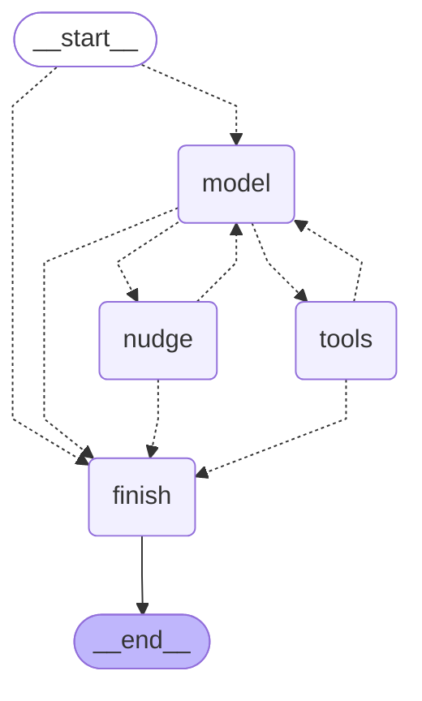

# PatchPilot — The Operator (Project 3)

A vulnerability remediation agent that scans a Python repo with Trivy, bumps a vulnerable pin in `requirements.txt`, runs the tests, and commits the fix to a sandbox branch only after a human approves the diff.

## Setup

```bash
python scripts/setup.py
```

Works the same on Windows, macOS and Linux (Python 3.10+, Git and Trivy installed; no `make` or `bash` needed). It creates `.venv` (the agent) and `sandbox/.venv` (the interpreter the template repo's tests run in), installs the dependencies, and downloads Trivy's vulnerability DB once into `.cache/trivy` so scans are offline and reproducible. Running it again keeps what is there.

## Run

```bash
python run.py
```

That fixes the template repo with the free rule-based model: no API key, no cost. Every edit and every issue waits for your `y`.

| Command | What it does |
|---|---|
| `python run.py` | Template repo, free `rules` model |
| `python run.py --target https://github.com/OWNER/REPO` | A real repo: cloned into the sandbox, fixed there |
| `python run.py --target C:/code/my-repo` | A local repo (its committed files only) |
| `python run.py --model gpt-4o-mini` | GPT chooses the tools (through LangChain); needs `OPENAI_API_KEY` in `.env`; cost counted against the $0.50 cap |
| `python run.py --engine loop` | The hand-written loop instead of the LangGraph engine (same steps, same stop rule) |
| `python run.py --no-reset` | Run again on the existing `sandbox/work` |
| `python run.py --target https://github.com/OWNER/REPO --issues github` | GitHub mode on that repo: issues (and the fix PR) go to `OWNER/REPO`; needs `GITHUB_TOKEN` with access to it |
| `python run.py --tui` | The terminal UI (below); the other flags prefill its form |

**Real repos are never edited in place.** A target is cloned into `sandbox/sources/<name>`, copied into the throwaway `sandbox/work`, and fixed there; its tests run in their own interpreter (`sandbox/.venvs/<name>`). A fix that ends `done` is committed on branch `patchpilot/fix` inside `sandbox/work` (the run prints `git -C sandbox/work show <sha>`); pushing it to the real repo is up to you. Only a root `requirements.txt` with `==` pins can be edited; findings elsewhere (other lockfiles) end in an issue for a human. A repo with no tests can never reach `done`, because the fix cannot be verified.

**Running a real repo's tests runs its code on your machine** (the sandbox is a folder and a venv, not a container). Only point PatchPilot at repos you trust.

Each run prints its stop reason, step count and cost, and writes its trajectory to `logs/<run_id>.jsonl`: a `start` record, one `model` record per turn (tokens, cost), one record per tool call (input, output, time), `checkpoint` and `recovery` events, and a final `stop` record with the named stop reason.

GPT models: prices live in `agent/model.py`; a model without a known price is refused, because the cost cap would never fire. `PATCHPILOT_MODEL` sets the default model. See [Engines and models](#engines-and-models) for the engine choice, local models and the plain-SDK path.

The Trivy DB is about 1.6 GB unpacked. To keep it on another disk, set `PATCHPILOT_TRIVY_CACHE` (in your environment or `.env`) before `python scripts/setup.py`.

## Terminal UI

```bash
python run.py --tui
python run.py --tui --target https://github.com/OWNER/REPO --issues github
```

A Textual app (`agent/tui.py`) on top of the same run:

- **Form:** the repo (a GitHub URL, a local folder, or empty for the template), the model, the engine, and a **GitHub issues** switch. With the switch on, issues go to the repo in the form, so a URL like `https://github.com/you/app` files on `you/app`.
- **Counter:** steps, cost and stop reason, live.
- **Steps:** a timeline of every model decision, tool call, approval and recovery, read from the run's JSONL trajectory as it is written.
- **Approval:** the exact diff with the scan before and after, or the issue / PR text, with **Approve (y)** and **Deny (n)**.

The safety logic is unchanged: the UI only supplies the answer to the same checkpoint the CLI uses. Only Approve is a yes. Quitting (`ctrl+q`) while a question is open answers no, and the run ends with its stop reason logged.

**GitHub issues on any repo:** GitHub only accepts the issue if your `GITHUB_TOKEN` can write issues on that repo. A fine-grained token covers repos you or your organization own; anything else fails with a plain error and nothing is filed. A bad setup (no token, a non-GitHub URL) is reported before anything is cloned. In GitHub mode the agent also proposes the fix PR and the merge, each behind its own approval; deny one to stop there.

## Engines and models

PatchPilot uses LangChain to talk to the LLM, LangGraph to run the agent, and LangSmith to trace runs. The parts that make it safe stay our own code and are shared by both engines: the tools and their strict schemas, the stop rule, the human checkpoint, recovery and the JSONL logs.

| `--engine` | What drives the run |
|---|---|
| `graph` (default) | A LangGraph `StateGraph` (`agent/graph.py`). Its conditional edges call our stop rule. |
| `loop` | The original hand-written loop (`agent/loop.py`), kept as the baseline. |

Both engines run the same step functions from `agent/loop.py`: the stop-rule check before every model call and before every tool call, the model call and its cost, the tool call with one retry, rollback after red tests, and the JSONL records. `tests/test_parity.py` runs 8 scenarios on both engines and requires the same stop reason, the same tool calls and identical trajectories. A model that never finishes stops at exactly 12 steps on both. LangGraph's `recursion_limit` is only a backstop above that. `PATCHPILOT_ENGINE` sets the default engine.

| `--model` | Model class | Cost |
|---|---|---|
| `rules` (default) | `RulesModel`: free, deterministic, no LLM | $0 |
| `gpt-4o-mini` (or any model name) | `LangChainModel`: `ChatOpenAI(...).bind_tools(...)`, one tool call per turn | From token usage, counted against the cap |
| `openai-raw:gpt-4o-mini` | `OpenAIModel`: the plain `openai` SDK, kept for comparison | Same |

A model without a known price is refused. Set `PATCHPILOT_PRICE_IN` and `PATCHPILOT_PRICE_OUT` (USD per 1M tokens) for any model not in `agent/model.py`.

**A local model (Ollama), free:** point the OpenAI-compatible client at Ollama and set the price to 0. No OpenAI key is needed; a placeholder is sent to the local server.

```bash
ollama pull llama3.1
OPENAI_BASE_URL=http://localhost:11434/v1 PATCHPILOT_PRICE_IN=0 PATCHPILOT_PRICE_OUT=0 \
  python run.py --model llama3.1
```

The model must support tool calling. Small local models often call tools badly; the registry rejects bad arguments in plain text, and the stop rule still ends the run.

The graph (`docs/graph.md`, kept current by a test). Dotted edges are conditional: each one calls our stop rule, and any stop reason routes to `finish`.



## Tracing with LangSmith

Tracing is **off** unless both of these are set (in your environment or `.env`):

```bash
LANGSMITH_TRACING=true
LANGSMITH_API_KEY=...          # never logged; LANGSMITH_PROJECT and LANGSMITH_ENDPOINT are optional
```

Each run is then one trace (`patchpilot_run`) with metadata `run_id`, `engine`, `model`, `target` and `stop_reason`. It contains a span per model call, per tool call and per checkpoint decision, and on the graph engine LangGraph's node runs too.

**What is sent to LangSmith:** the prompts and model replies, tool inputs and outputs (scan results and **the contents of repo files the agent reads**, such as `requirements.txt`), the checkpoint proposals (diffs, issue and PR text) with your yes/no, and the run metadata.

**What is never sent:** the tool context, environment variables, or tokens. Everything passes through `redact()` before it leaves the machine, in the LangSmith client itself, so LangGraph's and LangChain's own runs are covered too. It replaces the value of every secret variable (names containing KEY, TOKEN, SECRET or PASSWORD, and `OPENAI_*`, `GITHUB_*`, `LANGSMITH_*`, `PATCHPILOT_ADMIN_*`), GitHub and OpenAI token patterns, `Bearer` headers and credentials in URLs. Only trace repos whose files you are allowed to send to LangSmith.

The test suite can never send a trace: it removes every `LANGSMITH_*`/`LANGCHAIN_*` variable and forces tracing off, and the tracing tests inspect what the client would send on a recording session (`tests/test_tracing.py`).

## Recovery

| Failure | What happens |
|---|---|
| Scanner or test run times out, or returns garbled output | Retried once automatically (logged as a `recovery` retry). Write tools are never retried. |
| Tests fail right after an edit | `requirements.txt` goes back to the last version the tests passed on; the model is told and can try another version or file an issue. |
| Run ends early (limit, denial) with an untested edit | The edit is reverted; edits the tests already passed on stay. |

**Secrets never reach the target's code.** `run_tests` (pip and pytest) and `run_scan` (Trivy) run with a scrubbed environment: every variable whose name contains `KEY`, `TOKEN`, `SECRET` or `PASSWORD`, and every `OPENAI_*`, `GITHUB_*`, `LANGSMITH_*` and `PATCHPILOT_ADMIN_*` variable, is removed. `PATH`, `HOME`, proxy and certificate variables and `PATCHPILOT_TRIVY_CACHE` are kept (`tests/test_env_scrub.py`).

## Test

```bash
python run.py test
```

Call one tool by hand (logged to `logs/<run_id>.jsonl`):

```bash
python -m agent.tools read_file '{"path": "requirements.txt"}'
python -m agent.tools run_scan '{}'
python -m agent.tools run_tests '{}'
```

`edit_file`, `create_issue`, `open_pr` and `merge_pr` are not callable this way: they need a human approver, which `python -m agent` provides.

## Filing issues (`create_issue`)

The agent can hand a problem to a human: a vulnerability with no fixed version, or a fix that breaks the tests. The checkpoint shows the exact title and body and asks `File this issue? [y/n]`. Filing the same title twice returns the existing issue, `@mentions` are put in code spans so nobody is pinged, and a run files at most one issue.

| Mode | Set | Where the issue goes |
|---|---|---|
| `local` (default) | nothing | `logs/issues/<time>-NNNN.json` (git-ignored, survives sandbox resets) |
| `github` | `PATCHPILOT_ISSUES=github`, `PATCHPILOT_GITHUB_REPO=owner/name`, `GITHUB_TOKEN` | A real issue on that repo. Use a test repo. The token is never logged. |

An issue has a `purpose`: `handoff` (the default: a human takes over and the run stops) or `tracking` (GitHub mode only: the issue the fix PR will close; the run goes on). A run has at most one of each.

## GitHub mode

In GitHub mode the fix does not stop at the sandbox: it goes to the repo as a pull request, GitHub's CI checks it, and PatchPilot merges it. Every write waits for your `y`.

```
run_scan -> create_issue (tracking) -> read_file -> edit_file -> run_tests -> run_scan
         -> open_pr ("Fixes #N") -> CI runs on GitHub -> merge_pr -> GitHub closes the issue
```

That is 8 tool calls; the 12-step cap still applies. The run ends `done` only once the PR is merged. The local-mode flow is unchanged.

| Variable (in `.env`) | Value |
|---|---|
| `PATCHPILOT_ISSUES` | `github` |
| `PATCHPILOT_GITHUB_REPO` | Only needed when `--target` is not a GitHub URL (a GitHub `--target` is used instead). `owner/name` of a test repo (ours: a demo repo whose `main` is protected: PR required, status check `test` required, no force push) |
| `GITHUB_TOKEN` | Fine-grained token for that repo only: **Actions** read; **Contents**, **Issues**, **Pull requests** read and write. No Administration. |

Run it with the template on the demo repo: `python run.py --target https://github.com/OWNER/REPO`.

What the two GitHub write tools guarantee:

- `open_pr` refuses unless the tests are green and the last scan is clean in this run, and refuses if `requirements.txt` on the remote `main` differs from the sandbox baseline (drift). It uses the REST API only (no `git push`, so the token is never in a git config or URL), creates or moves branch `patchpilot/fix` to `main`, commits only `requirements.txt`, and opens the PR. `Fixes #N` is added only when this run opened a tracking issue. An already open fix PR is returned instead of a second one.
- `merge_pr` merges only the PR `open_pr` opened in this run, from `patchpilot/fix`. It waits for GitHub Actions on the PR's head commit (every 10 s, at most 180 s), refuses if CI fails or does not finish, and squash-merges pinned to the commit CI tested. An already merged PR is reported, not merged again.

### Resetting the demo repo (admin only)

```bash
python scripts/reset_demo_repo.py --dry-run   # show what it would do
python scripts/reset_demo_repo.py
```

It closes open issues and PRs that carry the PatchPilot footer, deletes `patchpilot/fix`, then saves `main`'s branch protection, removes it, force-updates `main` to the `baseline` tag and restores the exact same protection in a `finally` block (and checks it reads back the same), so protection comes back even if the reset fails.

It needs `PATCHPILOT_ADMIN_TOKEN` (fine-grained, demo repo only, with Administration) in **`.env.admin`**, which is git-ignored and read only by this script. **Why a separate token:** a force-push to protected `main` needs Administration rights. If the agent's token had them, a confused or prompt-injected run could remove the protection the whole flow relies on. The agent never loads `.env.admin`, and its subprocesses get a scrubbed environment anyway.

## Layout

| Path | What it is | Day |
|---|---|---|
| `agent/stop_rule.py` | Stop rule spec and `check()` | 1 |
| `sandbox/template/` | Target repo template (5 files, 3 tests, pinned vulnerable dependency) | 1 |
| `scripts/setup_trivy.sh` | Trivy check + DB cache download | 1 |
| `docs/proposal.md` | One-paragraph proposal sent to the instructor | 1 |
| `agent/tools/` | `run_scan`, `read_file`, `run_tests` (strict schemas, plain-text errors), `edit_file` | 2–3 |
| `agent/tools/registry.py` | `call_tool()`: validate, run, turn failures into plain text, log | 2 |
| `agent/calllog.py` | JSONL call log: input, output, ok, duration per call | 2 |
| `agent/tools/edit_file.py` | Write tool: one pin in `requirements.txt`, idempotent, no downgrades, sandbox only, approval before write | 3 |
| `agent/tools/create_issue.py` | Write tool: hand a problem to a human as an issue (local file or GitHub), idempotent by title, approval before filing | 5 |
| `agent/tools/open_pr.py`, `agent/tools/merge_pr.py` | GitHub mode write tools: open the fix PR (REST only, drift check), merge it after CI passes | Phase 1 |
| `scripts/reset_demo_repo.py` | Admin only: reset the demo repo to its `baseline` tag, protection restored | Phase 1 |
| `sandbox/reset.sh`, `agent/sandbox.py` | Rebuild `sandbox/work` from the template (or a scenario variant), baseline commit, branch `patchpilot/fix` | 3 |
| `agent/loop.py` | ReAct loop and the per-turn steps both engines share: one tool call per step, stop rule checked before every model call and every tool call | 4 |
| `agent/model.py` | `Model` interface, OpenAI implementation (cost per call from token usage), `ScriptedModel` stub for tests | 4 |
| `agent/lc_model.py` | `LangChainModel`: ChatOpenAI with bound tools behind the same `Model` interface; honors `OPENAI_BASE_URL` | Phase 2 |
| `agent/graph.py`, `docs/graph.md` | LangGraph engine over the shared steps; its drawing | Phase 2 |
| `agent/tracing.py` | Opt-in LangSmith tracing with redaction | Phase 2 |
| `agent/checkpoint.py` | Human checkpoint: full diff, real scan before and after (the proposed file is scanned in a temp folder), what it fixes / leaves open / introduces, then y/n. Only an explicit yes approves; no input is a no. Every decision is logged. `ScriptedHuman` stands in for the human in evals | 5 |
| `agent/recovery.py` | Retries, rollback to the last tested-good file, cleanup after partial failure | 6 |
| `agent/rules_model.py` | `RulesModel`: free, deterministic model behind the same interface (the default; the eval baseline) | 6 |
| `agent/targets.py` | Real repos as targets: clone into `sandbox/sources`, per-target test interpreter | 6 |
| `scripts/setup.py`, `run.py` | One setup command and one run command, any OS | 7 |
| `eval/` | Scenarios, fault injection, grader, results | 8–14, 16–17 |
| `threat_model.md` | Untrusted inputs and defenses | 15 |
| `errors.md` | Error taxonomy with a test per class | 13 |
| `logs/` | JSONL trajectory logs (one per run) | 2+ |

## Stop rule

The run ends on the **first** of these, in priority order:

1. Approval denied
2. No fixed version exists
3. Done — scan clean **and** tests green (GitHub mode: **and** the fix PR merged)
4. Handed off — the agent filed a handoff issue for a human (a tracking issue does not end the run)
5. 3 failed fix attempts
6. Cost cap — $0.50
7. Gave up — the model answered without calling a tool twice in a row (the first time it is nudged)
8. Step limit — 12 steps

Once `check()` returns a reason, the loop makes no further tool calls. One exception: after "no fixed version", a single `create_issue` call is still allowed so a human hears about it; the reason then stays `no_fixed_version`.

The loop checks the rule before every model call and again before every tool call (so a model call that crosses the cost cap never gets its tool run). A step is one model turn with at most one tool call; a turn where the model calls no tool still counts as a step. Every turn therefore adds a step, so a run makes at most 12 model calls and 12 tool calls no matter what the model does (`tests/test_loop.py`).

### Proof: one logged run per stop reason

```bash
python scripts/prove_stop_rule.py
```

Runs the real agent (loop, tools, checkpoint with a scripted human, recovery, JSONL log) once per stop reason on a fresh sandbox, with stand-ins only for trivy and pip/pytest, and writes `logs/proof/<reason>.jsonl`:

| Log | How the run is pushed there | Result |
|---|---|---|
| `done.jsonl` | rules model, fixable CVE | scan, read, edit, test, rescan: 5 steps |
| `approval_denied.jsonl` | the human answers `n` to the edit | stops after the denied edit: 3 steps, nothing written |
| `no_fixed_version.jsonl` | the CVE has no fixed version | one issue, then stop: 2 steps |
| `handed_off.jsonl` | the bump breaks the tests | rolled back, one issue, stop: 5 steps |
| `fix_attempts.jsonl` | a model that keeps bumping to versions that break the tests | stops after 3 failed fixes: 8 steps |
| `cost_cap.jsonl` | every model call costs $0.20 | the 3rd call crosses $0.50 and its tool never runs: 2 tool calls |
| `step_limit.jsonl` | a model that never finishes | exactly 12 steps |
| `gave_up.jsonl` | a model that never calls a tool | nudged once, then stopped: 2 steps |

`tests/test_stop_proof.py` reruns all eight and checks every log, the saved ones included: it ends with exactly one stop record naming its reason, nothing after it, at most 12 steps, no tool call after the cost cap, and no write without a human yes right before it.

## Team

| Member | Owns | Days |
|---|---|---|
| A | Tools, sandbox, recovery | 2, 3, 6 |
| B | Loop, stop rule, checkpoint, stop proof | 1, 4, 5, 17 |
| C | Scenarios, fault injection, grader, results | 8–14 |
| D | Threat model, injection cases, cost model, report | 15, 16, 18, 19 |

## Contributions
