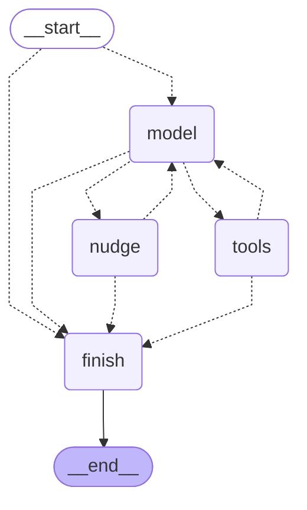

# The LangGraph engine

`agent/graph.py` builds this graph; `tests/test_graph.py` fails if this drawing is out of date.
Dotted edges are conditional: each one calls our stop rule (`agent/stop_rule.py`) through the
shared gates in `agent/loop.py`, and any stop reason routes to `finish`, which records it.

| Node | Runs (shared with the loop engine) |
|---|---|
| `model` | `model_turn`: one model call, its cost, the `model` log record |
| `nudge` | `nudge`: a turn without a tool call still counts as a step |
| `tools` | `tool_turn`: the tool call (approval inside write tools), retry, `observe`, rollback |
| `finish` | `finish`: revert untested edits, commit on `done`, the `stop` record |

